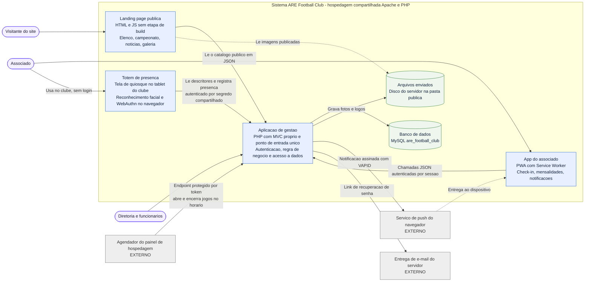
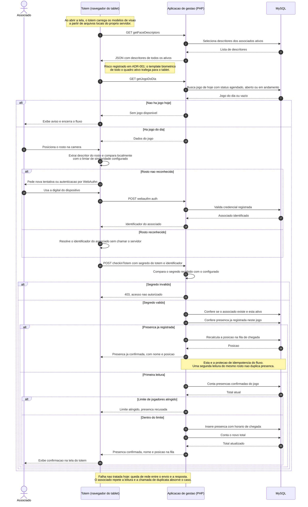
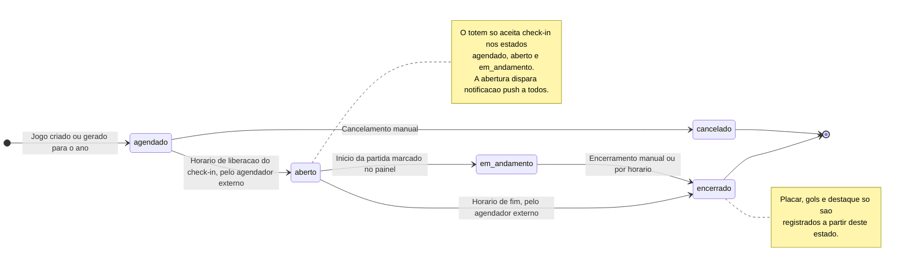

# Documentação arquitetural — A.R.E Football Club

Discovery de documentação do sistema de gestão do **A.R.E Football Club**, clube de
futebol amador de Morrinhos (GO). O objetivo não é desenhar um sistema novo: é
documentar o que já existe e está em produção, em formato versionável, revisável e
reutilizável como contexto para agentes de desenvolvimento.

Todos os diagramas são **diagrams as code** em Mermaid, renderizados pelo próprio
GitHub e validados por um script local. A fonte da verdade é o texto, não a imagem.

> Atividade da Unidade III do curso de Práticas Avançadas em Engenharia de Software
> com IA Generativa (AKCIT / CEIA / UFG).

## Sumário

- [O sistema em uma página](#o-sistema-em-uma-página)
- [Visão estrutural: containers](#visão-estrutural-containers)
- [Visão comportamental: check-in no totem](#visão-comportamental-check-in-no-totem)
- [Ciclo de vida do jogo](#ciclo-de-vida-do-jogo)
- [O que a IA gerou e o que eu mudei](#o-que-a-ia-gerou-e-o-que-eu-mudei)
- [Checklist de revisão](#checklist-de-revisão)
- [Lacunas abertas](#lacunas-abertas)
- [Como usar isto como contexto para agentes](#como-usar-isto-como-contexto-para-agentes)
- [Estrutura do repositório](#estrutura-do-repositório)

## O sistema em uma página

Sistema de gestão de um clube amador, em produção. Cobre associados, mensalidades,
presença em jogos, comandas do bar, caixa, produtos, fornecedores, funcionários e a
landing page pública.

| Dimensão | Realidade |
| --- | --- |
| Linguagem | PHP, MVC próprio, sem framework |
| Dados | MySQL único, acesso por PDO |
| Front-end | HTML, CSS e JS sem etapa de build |
| Hospedagem | Compartilhada, sem Docker e sem integração contínua |
| Time | Um desenvolvedor, em tempo parcial |
| Dados sensíveis | CPF, endereço, descritor facial e credencial WebAuthn |

O roteiro completo, com escopo, limites, integrações, restrições e dependências
proibidas, está em [docs/descricao-sistema.md](docs/descricao-sistema.md).

## Visão estrutural: containers

Nível de containers, inspirado no C4. Mostra o que executa, o que guarda estado e o
que é de terceiro. Não mostra rotas nem classes.



**Como ler.** Os três clientes conversam com a mesma aplicação PHP, por caminhos de
autenticação diferentes: sessão do associado, sessão de funcionário no painel,
segredo compartilhado no totem e nenhuma autenticação no catálogo público da landing
page. Essa é a fronteira que mais importa revisar quando algo muda.

O desenho também deixa visível uma dependência que passava despercebida: a transição
de estado dos jogos depende de um agendador que vive fora do sistema.

## Visão comportamental: check-in no totem

Jornada crítica do clube. Acontece em campo, em poucos minutos, com vários associados
em fila e rede móvel instável. O diagrama inclui o caminho feliz, três caminhos de
recusa e o ponto onde a idempotência protege o fluxo.



**O que este diagrama revelou.** Duas coisas que o texto escondia. A primeira é que o
reconhecimento facial acontece no navegador, o que obriga o servidor a entregar o
descritor biométrico de todo o quadro ativo para um tablet que fica em campo. A
segunda é que a proteção contra presença duplicada não é uma decisão explícita de
idempotência: é efeito colateral da checagem de duplicata. Funciona, mas ninguém
registrou que aquele trecho é o que impede efeito duplicado em caso de repetição.

## Ciclo de vida do jogo

O risco aqui não é ordem de mensagens, é transição inválida. Por isso máquina de
estados, e não mais um diagrama de sequência.



## O que a IA gerou e o que eu mudei

O fluxo seguiu o roteiro da unidade: descrever, pedir lacunas e perguntas, só então
gerar o diagrama. Os prompts estão em [docs/prompts](docs/prompts). Os ajustes abaixo
são o que separa um desenho plausível de um desenho verdadeiro.

| # | O que o modelo propôs | O que eu mudei e por quê |
| --- | --- | --- |
| 1 | Containers separados para serviço de presença, serviço de site e API | Unifiquei na aplicação de gestão. São o mesmo processo PHP, com o mesmo ponto de entrada. Separar sugeriria microsserviços que não existem, e um diagrama que mente é pior que nenhum |
| 2 | Reconhecimento facial executado no servidor | Corrigido para o navegador do totem, que é o que o código faz. Essa única correção mudou a conversa inteira e virou o ADR-001 |
| 3 | Rotas e endpoints no diagrama de containers | Removidos. Endpoint só aparece no diagrama de sequência, onde a ordem das chamadas é o objeto da análise. Um nível por desenho |
| 4 | Serviço de push dentro da fronteira do sistema | Movido para fora e marcado como externo. É infraestrutura de terceiro, com falha e latência fora do meu controle |
| 5 | Agendador externo ausente | Acrescentado. Sem ele, os jogos não abrem nem encerram sozinhos. Era um ponto único de falha invisível na documentação |
| 6 | Tudo em um diagrama só | Separado em três. Estrutura, jornada crítica e ciclo de vida respondem perguntas diferentes e são revisados por motivos diferentes |
| 7 | Valores concretos de limiar de similaridade e de tempo limite | Removidos. O modelo não tinha como saber esses números. Onde ele chutou, troquei por "limiar configurado" e abri uma lacuna de medição |
| 8 | Idempotência não mencionada | Anotada no ponto exato onde acontece, depois de confirmar no código. Sem isso, um refactor futuro remove a checagem achando que é validação de formulário |

Lição que levo: o valor não veio do diagrama gerado, veio da diferença entre o que o
modelo supôs e o que o código faz. Cada divergência apontou ou um erro de
documentação ou um risco real.

## Checklist de revisão

Aplicável em pull request, por quem não acompanhou esta conversa.

1. O diagrama está em um único nível, sem misturar container com rota ou classe?
2. Toda integração de terceiro está marcada como externa?
3. Algum cliente fala com o banco sem passar pela aplicação de gestão?
4. A landing page continua sem depender de sessão?
5. O totem continua restrito a escrever presença, sem receber sessão de administrador?
6. Todo caminho de falha desenhado tem resposta definida para o usuário final?
7. Onde há repetição possível, está explícito o que impede efeito duplicado?
8. Algum número apareceu no diagrama sem fonte? Se sim, vira lacuna ou vira medição.
9. Mudou o fluxo no código e o diagrama correspondente acompanhou no mesmo commit?
10. O desenho ajuda alguém a revisar uma decisão, ou virou ilustração?

## Lacunas abertas

Registradas, não resolvidas. Cada uma vale um ADR quando for hora de decidir.

1. **Biometria no cliente.** O descritor facial de todo o quadro ativo é entregue ao
   navegador do totem. Decisão pendente em
   [ADR-001](docs/adr/ADR-001-reconhecimento-facial-no-cliente.md).
2. **Retenção de dado biométrico.** Não há política de retenção, revogação nem
   consentimento registrado.
3. **Contrato do catálogo público.** O endpoint consumido pela landing page não tem
   contrato versionado. Mudar um campo quebra o site sem aviso.
4. **Segredo do totem.** É constante fixa em configuração. Falta definir rotação e o
   procedimento para tablet perdido.
5. **Dependência do agendador.** Se ele parar, nenhum jogo abre e ninguém é avisado.
   Não existe alarme.
6. **Limiar de reconhecimento.** Está fixo no código do totem e não há métrica de
   falso positivo ou falso negativo para calibrá-lo.
7. **Queda de rede no check-in.** O comportamento hoje é tentar de novo. Falta decidir
   se vale confirmação local no tablet.

## Como usar isto como contexto para agentes

A documentação foi escrita para ser lida por pessoas e por agentes de código. Para uma
tarefa de implementação, a ordem que funciona é:

1. Dar o roteiro em [docs/descricao-sistema.md](docs/descricao-sistema.md) como
   contexto, porque ele declara limites e dependências proibidas.
2. Dar o diagrama do nível certo. Mudança de integração pede o estrutural, mudança de
   jornada pede o de sequência, mudança de regra de transição pede a máquina de
   estados.
3. Exigir que o agente aponte, antes de codar, qual item do diagrama a mudança altera.
   Se nenhum, ou a mudança é trivial ou o diagrama está desatualizado.
4. Usar o checklist acima como critério de revisão da saída, em vez da impressão de
   que o código parece certo.

A regra que fecha o ciclo: mudou o fluxo, o diagrama muda no mesmo commit. Diagrama
que atrasa em relação ao código deixa de ser contexto confiável e vira ruído.

## Estrutura do repositório

```text
.
├── README.md                     documentação principal, com os diagramas renderizados
├── docs/
│   ├── descricao-sistema.md      roteiro em linguagem natural
│   ├── adr/                      registros de decisão
│   ├── diagramas/                fontes .mmd, uma por diagrama
│   └── prompts/                  prompts usados em cada etapa
└── tools/validate-mermaid.mjs    valida a sintaxe de todos os .mmd
```

### Validar os diagramas localmente

```bash
npm install mermaid jsdom
node tools/validate-mermaid.mjs docs/diagramas/*.mmd
```

O script falha com código de saída diferente de zero se qualquer diagrama não
analisar. É o mínimo de validação automatizada que roda sem servidor de integração
contínua, que é exatamente a restrição deste projeto.
